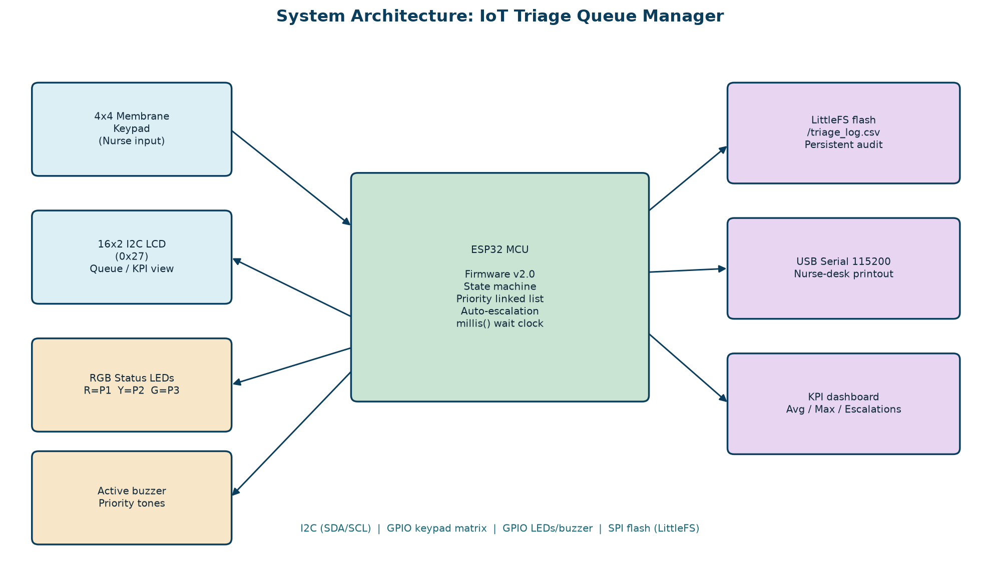
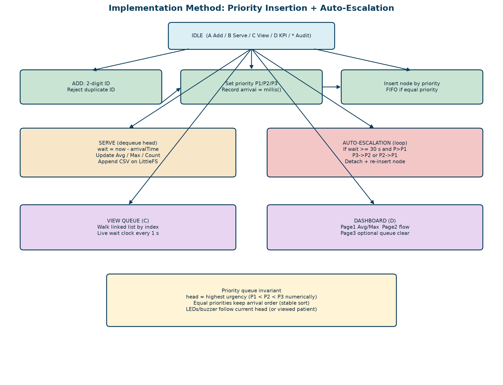

# IoT-Based Emergency Department Patient Triage Queue Manager (ESP32)

An ESP32 nurse-station prototype that manages an emergency-department waiting queue by clinical urgency. It uses a dynamic priority linked list, time-based auto-escalation, wait-time KPIs and a LittleFS audit log that survives resets.

**Live simulation (Wokwi):** https://wokwi.com/projects/476662586314864641

## Team Members

| Name | Roll No. | Role |
|------|----------|------|
| Hanshith D | CB.SC.U4CSE25616 | Firmware / data structures |
| Nambi Prasanna B | CB.SC.U4CSE25641 | Hardware integration (keypad, LCD, LEDs, buzzer) |
| Baru Venkata Abhinav | CB.SC.U4CSE25607 | UX state machine and KPI dashboard |
| Shashank Sivakumar | CB.SC.U4CSE25655 | Persistent log / Serial nurse-station report |

## Features

- **Priority queue:** P1 Emergency → P2 Urgent → P3 Normal, with FIFO order kept within each priority.
- **Dynamic linked list:** patient nodes are allocated with `malloc`/`free`, with no fixed-size array.
- **Wait-time tracking:** a live wait clock on the LCD, plus average, maximum, served and escalated counts.
- **Auto-escalation:** a patient waiting at least 30 s (lab setting) is promoted, which prevents starvation.
- **Persistent audit log:** every served patient is appended to `/triage_log.csv` on LittleFS flash.
- **Audio-visual cues:** red, yellow and green LEDs and a distinct buzzer tone for each priority.
- **Input validation:** blank and duplicate IDs are rejected, `*` cancels, and memory-full is handled.

## Hardware & Pin Mapping

| Component | ESP32 Pin |
|-----------|-----------|
| 16x2 LCD (I2C, addr 0x27) | SDA 21, SCL 22, VCC 5V |
| 4x4 Keypad rows R1–R4 | 13, 12, 14, 27 |
| 4x4 Keypad cols C1–C4 | 26, 25, 33, 32 |
| Red LED (P1 Emergency) | 15 → LED → 220 Ω → GND |
| Yellow LED (P2 Urgent) | 2 → LED → 220 Ω → GND |
| Green LED (P3 Normal) | 5 → LED → 220 Ω → GND |
| Buzzer | 4 |

Board: ESP32 DevKit C v4. Serial monitor runs at 115200 baud.

## Keypad Controls

| Key | Action |
|-----|--------|
| **A** | Add patient: enter a 2-digit ID, press `#`, choose priority `1`/`2`/`3`, press `#` |
| **B** | Serve the next (highest-priority) patient and log its wait time |
| **C** | Browse the waiting queue (`C` or `#` for next) |
| **D** | KPI dashboard (3 pages; page 3 lets you clear the queue with `#`) |
| **\*** | In idle: reprint the audit log on Serial. Elsewhere: cancel / back |

## How to Run

**Option 1: Wokwi in the browser (easiest)**
1. Open the Wokwi link above.
2. Press ▶ Start Simulation and use the on-screen keypad.

**Option 2: Real ESP32**
1. Install Arduino IDE and the ESP32 board package (Espressif).
2. Install the libraries **Keypad** (Mark Stanley) and **LiquidCrystal I2C**. `FS` and `LittleFS` come with the ESP32 core.
3. Wire the circuit as shown in the pin table (or see `diagram.json`).
4. Open `triage.ino` (Arduino IDE will offer to put it in a `triage` folder; click OK), select *ESP32 Dev Module*, and upload.
5. Open the Serial Monitor at 115200 baud.

## Files

| File | Description |
|------|-------------|
| `triage.ino` | Final firmware (v2.0, with LittleFS log, dashboard, queue browser) |
| `sketch_v1.ino` | Earlier version (without log / dashboard) |
| `diagram.json` | Wokwi circuit |
| `wokwi.toml` | Wokwi VS Code extension config |
| `libraries.txt` | Wokwi library list |
| `ED_Patient_Triage_Queue_Case_Study.docx` | Case study report |
| `architecture.png`, `flow.png` | Architecture and implementation diagrams |

## Architecture

## Case Study Report

- 📄 [Read the report (PDF)](https://github.com/Nambi25/HospitalTriage-ESP32/blob/main/HospitalTriage_Final_Report.pdf)
- 📝 [Download Word version](https://github.com/Nambi25/HospitalTriage-ESP32/raw/main/HospitalTriage_Final_Report.docx)

## Future Work

- Barcode/NFC wristband IDs in place of 2-digit tokens
- Per-priority escalation thresholds in minutes
- Wi-Fi/MQTT dashboard and cloud backup of the log
- RTC/NTP wall-clock timestamps
